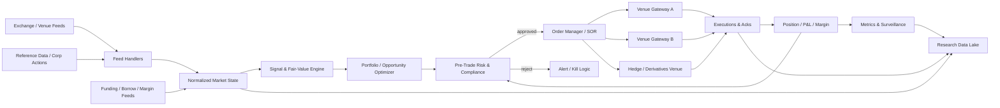
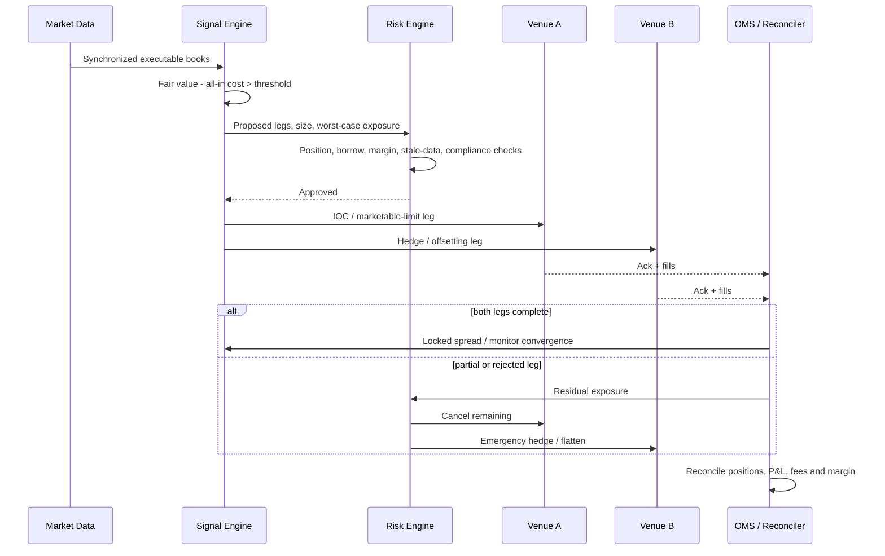

> **Research cutoff:** October 23, 2026. Educational/engineering research; not legal or investment advice. Source citation links have been reconstructed from primary publications and official documentation.

**Contents:** [Executive summary](#executive-summary) · [Strategies](#foundations-and-strategy-taxonomy) · [Models and validation](#models-signals-data-and-edge-validation) · [Execution](#execution-and-implementation-architecture) · [Risks](#risk-performance-and-lessons-from-successful-and-failed-arbitrage) · [Regulation](#regulatory-landscape-and-ethical-boundaries) · [Playbooks](#practitioner-playbooks) · [Build checklist](#actionable-build-checklist-and-implementation-timeline)

## Executive summary

**Arbitrage is not “finding two prices that look different.” It is the engineering discipline of identifying a payoff-equivalent or statistically linked price discrepancy, proving that it survives every realistic cost and constraint, and then capturing it before execution, funding, liquidity, counterparty, or regulatory risk overwhelms the edge.** Classical arbitrage is closest to riskless when simultaneous trades lock in non-negative cash flows with positive payoff in at least one state. Most strategies marketed as arbitrage—statistical arbitrage, merger arbitrage, convertible arbitrage, volatility arbitrage, many crypto basis trades—are actually **relative-value trades with residual risk**. The academic literature on limits to arbitrage and actual crises makes this distinction crucial: mispricing can widen before converging, financing can disappear, and leverage can force an otherwise correct trade to liquidate at precisely the wrong time. ([Mitchell & Pulvino, 2012](https://doi.org/10.1016/j.jfineco.2011.09.002); [SEC LTCM testimony](https://www.sec.gov/newsroom/speeches-statements/tsty1498-testimony-hedge-fund-activities-us-financial-markets))

The central equation for a practitioner is therefore not “spread > 0,” but:

$$
\boxed{
E[\Pi_{\text{net}}]
=
E[\Pi_{\text{gross}}]
-C_{\text{spread}}
-C_{\text{fees}}
-C_{\text{impact}}
-C_{\text{funding}}
-C_{\text{borrow}}
-C_{\text{FX}}
-C_{\text{tax/settlement}}
-E[L_{\text{legging}}]
-E[L_{\text{adverse selection}}]
-E[L_{\text{failure}}]
}
$$

and the trade should be sized on **net edge divided by loss under stress**, not on the apparent spread.

The most important conclusions of this research are:

1. **The highest-quality arbitrage is structural rather than predictive.** Put-call parity, cash-and-carry, ETF creation/redemption, cross-listed instruments, triangular FX, spot/futures basis and certain cross-venue discrepancies have a theoretically defined fair-value relationship. Statistical arbitrage instead estimates a distribution and relies on mean reversion; merger arbitrage estimates deal-completion probabilities; convertible arbitrage mixes equity-option, credit, funding and borrow exposures. Thus their use of the word “arbitrage” should not imply equivalently low risk. Research on merger arbitrage, for example, found historically positive excess returns but a strongly nonlinear downside profile resembling short index-put exposure. ([Mitchell & Pulvino, 2001](https://doi.org/10.1111/0022-1082.00401))

2. **Execution quality is frequently more important than signal sophistication.** High-frequency triangular FX discrepancies can exist in quoted data yet be too fleeting to capture reliably. A study using executable FX prices found most opportunities small and short-lived and concluded that a trader would have needed to win an unrealistically large fraction of the races to remain profitable. FCA research on equity latency races similarly found very short, frequent races, concentrated participation, and economically meaningful aggregate effects even though individual races were small. ([Foucault, Kozhan & Tham](https://cepr.org/publications/dp9925); [FCA latency-race study](https://www.fca.org.uk/publications/occasional-papers/occasional-paper-no-50-quantifying-high-frequency-trading-arms-race-new-methodology))

3. **Never backtest arbitrage using only mid-prices or bars.** A credible test must model bid/ask direction, depth, queue priority, partial fills, rejected and cancelled orders, stale data, latency, market impact, borrow availability, corporate actions, exchange fees/rebates, financing, margin, venue outages and settlement. For HFT, even exchange message traffic—not merely reconstructed limit-order-book states—can matter because losing attempts to trade or cancel reveal races that a conventional book snapshot cannot show. ([FCA latency-race study](https://www.fca.org.uk/publications/occasional-papers/occasional-paper-no-50-quantifying-high-frequency-trading-arms-race-new-methodology))

4. **Direct market data and synchronized timestamps become part of the strategy.** Nasdaq TotalView distributes full-depth order-book information through ITCH; NYSE Integrated Feed provides order-by-order depth, trades, imbalances and status information; CME MDP 3.0 provides low-latency derivatives-market data; and Coinbase offers WebSocket/FIX interfaces, including FIX market-data access for latency-sensitive clients. CME ceased supporting MDP 3.0 multicast on its 1-Gbps services in June 2026, illustrating how infrastructure dependencies themselves evolve. ([Nasdaq TotalView ITCH](https://www.nasdaqtrader.com/content/technicalsupport/specifications/dataproducts/NQTVITCHspecification.pdf); [NYSE Integrated Feed](https://www.nyse.com/data-products/catalog/integrated-feed); [CME market data](https://www.cmegroup.com/market-data/distributor/market-data-platform.html); [Coinbase Exchange API](https://www.coinbase.com/developer-platform/products/exchange-api); [CME June 2026 advisory](https://www.cmegroup.com/notices/electronic-trading/2026/06/20260615.html))

5. **Funding is an arbitrage risk, not merely a cost.** LTCM earned annual returns exceeding 40% during its early years but used extreme leverage; SEC testimony reported leverage exceeding 50:1 and a 52% loss in equity from January through August 1998, with most of the loss concentrated in August as convergence relationships moved sharply against it. The lesson is not simply “avoid leverage”; it is that convergence horizons and funding horizons must be matched. ([SEC LTCM testimony](https://www.sec.gov/newsroom/speeches-statements/tsty1498-testimony-hedge-fund-activities-us-financial-markets))

6. **Crowding can turn market-neutral portfolios into common-factor portfolios.** Khandani and Lo documented unprecedented losses among quantitative long/short funds in August 2007 and evidence consistent with coordinated deleveraging of similarly constructed portfolios. “Dollar neutral,” “beta neutral,” and “sector neutral” do not protect against a shared liquidation factor. ([Khandani & Lo](https://www.nber.org/papers/w14465))

7. **Crypto arbitrage is real but historically segmented by capital mobility and counterparty constraints.** Makarov and Schoar documented large recurring cryptocurrency price deviations across exchanges and found discrepancies particularly important across countries, consistent with capital controls and segmented arbitrage capital. A modern implementation should normally pre-position inventory on both venues instead of assuming blockchain transfers can complete while an opportunity remains open. ([Makarov & Schoar](https://mitsloan.mit.edu/cfi/trading-and-arbitrage-cryptocurrency-markets); [Makarov & Schoar](https://dspace.mit.edu/entities/publication/7f91bfb5-ba77-4d0e-9c79-ec75e104e6cc))

8. **There is no defensible universal “typical annual return” for arbitrage.** Returns depend on leverage, balance-sheet usage, capacity, fees, borrow and market regime. Historical evidence is more useful when expressed as Sharpe ratio, spread, volatility premium or excess return. Avellaneda and Lee reported a 1.44 annualized Sharpe ratio for a PCA-based U.S. equity statistical-arbitrage backtest over 1997–2007, but only 0.9 over 2003–2007; Mitchell and Pulvino estimated roughly 4% annual transaction-cost-adjusted excess return historically for merger arbitrage. Neither number should be projected forward. ([Avellaneda & Lee](https://doi.org/10.2139/ssrn.1153505); [Mitchell & Pulvino, 2001](https://doi.org/10.1111/0022-1082.00401))

9. **Regulation belongs inside the execution engine.** U.S. market-access rules require broker-dealers providing market access to maintain risk-management controls; MiFID II/RTS 6 imposes extensive controls and testing on EU algorithmic traders; the UK FCA imposes resilience and trading-control requirements; China now expressly regulates program trading and requires enhanced reporting for high-frequency activity; Taiwan controls short selling, securities borrowing and co-location access; Singapore regulates DMA, short-position reporting and technology risk. Manipulative practices such as spoofing are not arbitrage. ([SEC market-access rule](https://www.sec.gov/rules-regulations/2011/06/risk-management-controls-brokers-or-dealers-market-access); [ESMA MiFID II Art. 17](https://www.esma.europa.eu/publications-and-data/interactive-single-rulebook/mifid-ii/article-17-algorithmic-trading); [EU RTS 6](https://eur-lex.europa.eu/legal-content/EN/TXT/?uri=CELEX:32017R0589); [FCA MAR 7A](https://handbook.fca.org.uk/handbook/mar7a); [SSE program-trading requirements](https://english.sse.com.cn/news/newsrelease/c/c_20250717_10785724.shtml); [HKEX Northbound reporting](https://www.hkex.com.hk/Mutual-Market/Stock-Connect/Reference-Materials/Northbound-Program-Trading-Reporting?sc_lang=en); [TWSE SBL rules](https://twse-regulation.twse.com.tw/m/en/LawContent.aspx?FID=FL007044); [SGX DMA rules](https://rulebook.sgx.com/rulebook/45a2-conditions-governing-direct-market-access))

10. **The “master” arbitrageur builds an execution and risk system before scaling alpha.** The proper maturity path is: theoretical parity → clean data → cost model → event-driven simulator → shadow trading → tiny capital → stress validation → controlled scaling. For HFT, add direct feeds, colocation, deterministic low-latency code, hardware timestamping, redundant connectivity, exchange certification and automated kill controls before optimizing microseconds.

This report reflects information available through **October 23, 2026**. Regulatory treatment is activity-, instrument-, venue- and entity-specific; the regulatory discussion is therefore a practitioner map, not a substitute for counsel. Tax, sanctions, beneficial-ownership reporting and fund-registration requirements are not exhaustively treated.

## Foundations and strategy taxonomy

The useful dividing line is between **deterministic parity arbitrage**, where economic equivalence gives you a theoretical boundary, and **probabilistic relative-value arbitrage**, where convergence depends on a statistical, contractual or behavioral hypothesis.

For a portfolio of positions $$\theta$$, current prices $$p$$, and future state-dependent payoffs $$X(\omega)$$, the purest arbitrage satisfies approximately:

$$
\theta^\top p \le 0,
\qquad
\theta^\top X(\omega)\ge0\ \forall\omega,
\qquad
P[\theta^\top X>0]>0.
$$

Real markets weaken this definition because transactions have spreads, fees, taxes, borrow constraints, funding requirements and settlement risk. Consequently the executable condition is not theoretical mispricing but:

$$
\text{mispricing} >
\text{all-in deterministic cost}
+
\text{risk buffer}.
$$

This is exactly why “limits to arbitrage” matter: capital constraints and financing can prevent rational traders from immediately correcting even obvious relative mispricing. The financing contraction studied by Mitchell and Pulvino during the financial crisis showed that withdrawal of leverage prevented relative-value funds from maintaining similar assets priced at substantially different levels. ([Mitchell & Pulvino, 2012](https://doi.org/10.1016/j.jfineco.2011.09.002))

**Cash-and-carry and futures basis.** For a continuously compounded financing rate $$r$$ and yield or carry $$q$$, the textbook equity-index relationship is:

$$
F_{0,T}^{*}=S_0e^{(r-q)T}.
$$

Define:

$$
b = \frac{F_{\text{market}}}{S}-1.
$$

A cash-and-carry trader buys spot and sells an overpriced future only when the basis exceeds financing, dividends/carry uncertainty, execution cost, balance-sheet cost and settlement risk. The inverse trade may require shorting the underlying, making borrow availability part of the parity condition. In crypto, spot/perpetual or spot/futures basis additionally incorporates funding payments, custody risk, collateral haircut, stablecoin/fiat basis and exchange default risk.

**FX covered-interest and spatial arbitrage.** For currencies $$A$$ and $$B$$, using a consistent quote convention,

$$
F_{A/B}
\approx
S_{A/B}\frac{1+r_A T}{1+r_B T}.
$$

Deviations from covered-interest parity may reflect balance-sheet scarcity and funding/capital constraints rather than “free money.” Spatial arbitrage generalizes the idea: buy an economically identical asset in one venue and sell it in another, but only after conversion, transfer, tax, clearing, settlement and inventory costs.

**Triangular arbitrage.** Given executable rates rather than midpoints, form a directed cycle. For three conversion rates $$r_1,r_2,r_3$$,

$$
R_{\triangle}=r_1r_2r_3.
$$

A trade exists only if the correctly selected **bid/ask** product, after fees and sizing through available depth, produces $$R_{\triangle}>1$$. Academic high-frequency FX work confirms that apparent triangular opportunities can be extremely fleeting and that profitability can disappear once competition for executable quotes is considered. ([Foucault, Kozhan & Tham](https://cepr.org/publications/dp9925))

**Option parity and volatility arbitrage.** European-style put-call parity with continuous dividend yield is:

$$
C-P=S_0e^{-qT}-Ke^{-rT}.
$$

A large deviation can be traded through conversions/reversals subject to exercise conventions, borrow and transaction costs. Volatility arbitrage is less deterministic. Options are converted into an implied volatility $$\sigma_{\text{imp}}$$, while the trader forecasts future realized variance. A delta-hedged long-option position has an approximate local volatility P&L relationship of the form:

$$
d\Pi \approx
\frac12\Gamma S^2
(\sigma_{\text{real}}^2-\sigma_{\text{imp}}^2)\,dt
-\text{hedging costs},
$$

plus higher-order and jump terms. CME educational material distinguishes implied volatility as forward-looking market pricing from realized volatility observed from past price variation; Cboe historical analysis found that VIX implied volatility systematically exceeded subsequent realized S&P 500 volatility on average over its studied sample. ([Cboe implied vs. realized volatility](https://www.cboe.com/insights/posts/white-paper-shows-volatility-risk-premium-facilitated-higher-risk-adjusted-returns-for-put-index/))

*Recreated from the published 1990–2018 averages, not the original Cboe graphic.*

Cboe reported average VIX of **19.3%** and subsequent realized volatility of **15.1%** over 1990–2018, a 4.2-volatility-point historical premium. This is evidence of a volatility risk premium, **not** a 4.2% arbitrage return: option skew, gamma, jumps, hedging frequency and transaction costs determine realizable P&L. ([Cboe volatility-risk-premium study](https://www.cboe.com/insights/posts/white-paper-shows-volatility-risk-premium-facilitated-higher-risk-adjusted-returns-for-put-index/))

**ETF arbitrage.** Authorized participants and market makers compare the ETF price with the executable value of its creation/redemption basket, accounting for creation fees, FX, taxes, borrow, local-market closures and stale underlying prices. An ETF premium is not automatically exploitable if primary-market creations are suspended. Taiwan supplies a dramatic example: TWSE reported that the Yuanta China Technology 50 ETF experienced a secondary-market premium exceeding 200% in 2024 while the relevant Chinese market was closed and primary subscriptions were halted. That is a textbook demonstration that an apparently enormous spread can persist when the arbitrage mechanism is constrained. ([TWSE 00887 ETF case](https://www.twse.com.tw/market_insights/en/detail/8a8216d69bde495d019c031643da009d))

**Statistical arbitrage and pairs trading.** Here the two assets need not have identical cash flows. The hypothesis is that a stationary residual exists:

$$
X_t = \log P_{1,t}-\beta\log P_{2,t},
$$

or more generally:

$$
r_{i,t}=\alpha_i+\beta_i^\top f_t+\epsilon_{i,t}.
$$

You long relatively cheap residuals and short expensive ones while neutralizing systematic exposures. Avellaneda and Lee model factor residuals, including PCA- and sector-ETF-based constructions, as mean-reverting processes and emphasize the systematic, market-neutral, many-small-bets character of statistical arbitrage. ([Avellaneda & Lee](https://doi.org/10.2139/ssrn.1153505))

A common continuous-time model is Ornstein-Uhlenbeck:

$$
dX_t=\kappa(\mu-X_t)dt+\sigma dW_t.
$$

It implies:

$$
\operatorname{Var}_{eq}(X)=\frac{\sigma^2}{2\kappa},
\qquad
t_{1/2}=\frac{\ln 2}{\kappa},
$$

and a standardized signal:

$$
z_t=
\frac{X_t-\mu}{\sigma/\sqrt{2\kappa}}.
$$

Avellaneda and Lee explicitly estimate mean reversion and build entry/exit signals from standardized residuals; their backtest also included transaction-cost assumptions rather than assuming frictionless execution. ([Avellaneda & Lee](https://doi.org/10.2139/ssrn.1153505))

Cointegration is preferable to raw correlation when the thesis concerns a stable long-run spread. Correlation can be high while two price levels wander apart indefinitely; a cointegrating vector attempts to make the linear combination stationary. Dynamic hedge ratios can be estimated with rolling regressions or state-space/Kalman models, but every additional parameter raises overfitting and regime-risk concerns.

**Merger or risk arbitrage.** For a cash offer at $$P_{\text{deal}}$$, target price $$P_t$$, estimated completion probability $$p$$, and estimated broken-deal value $$P_{\text{break}}$$:

$$
E[P_T]
=
pP_{\text{deal}}+(1-p)P_{\text{break}},
$$

and

$$
E[\Pi]
=
E[P_T]-P_t-\text{carry}-\text{hedge costs}.
$$

For a stock deal offering $$h$$ acquirer shares per target share, the classic hedge is approximately long one target share and short $$h$$ acquirer shares, then adjust for collars, elections, dividends, borrow and deal terms. The critical variable is not merely the quoted spread but $$p$$, the break value and time-to-resolution. Mitchell and Pulvino's study of 4,750 mergers found about 4% annual transaction-cost-adjusted excess return historically but also strongly asymmetric losses during severe market declines. ([Mitchell & Pulvino, 2001](https://doi.org/10.1111/0022-1082.00401))

**Convertible arbitrage.** A convertible can be schematically decomposed as:

$$
V_{\text{CB}}
\approx
V_{\text{straight bond}}
+
V_{\text{equity option}}
+
V_{\text{embedded terms}}.
$$

An arbitrageur often buys the convertible and shorts $$\Delta=\partial V/\partial S$$ shares, seeking cheap embedded optionality or attractive credit/volatility relative value. The actual book has credit spread, interest-rate, equity delta, gamma, vega, borrow and liquidity exposures; its financing requirements can dominate the apparent valuation edge. It is therefore best understood as **multi-factor relative value**, not a riskless option mispricing.

**Latency arbitrage.** A fast participant detects that one venue's executable quote is stale relative to a faster price-discovery venue and attempts to trade against that quote before it is cancelled or repriced. A simplified signal is:

$$
E_t=
V_t^{\text{fast}}
-
P_t^{\text{stale}}
-
C_{\text{trade}}
-
E[\text{adverse-selection/failed-leg loss}].
$$

FCA research using exchange message data estimated that latency races in FTSE 100 stocks were frequent, had a modal duration of only about 5–10 microseconds, and involved a sizable fraction of trading volume; this explains why ordinary Internet/API infrastructure is not meaningfully competitive in the most latency-sensitive segment. ([FCA latency-race study](https://www.fca.org.uk/publications/occasional-papers/occasional-paper-no-50-quantifying-high-frequency-trading-arms-race-new-methodology))

**Crypto cross-exchange and triangular arbitrage.** For buying on venue $$A$$ and selling on venue $$B$$,

$$
\Pi_{\text{unit}}
=
B_B(1-f_B)
-
A_A(1+f_A)
-
C_{\text{transfer}}
-
C_{\text{funding}}
-
C_{\text{FX}}
-
C_{\text{inventory}}.
$$

The professional implementation normally holds both quote currency and asset inventory on both exchanges and rebalances asynchronously. Waiting to withdraw the purchased crypto and deposit it elsewhere converts an arbitrage into a directional exposure during blockchain confirmation and exchange-processing time. Makarov and Schoar's research documents recurring cross-exchange discrepancies and emphasizes the role of international market segmentation and capital controls. ([Makarov & Schoar](https://mitsloan.mit.edu/cfi/trading-and-arbitrage-cryptocurrency-markets); [Makarov & Schoar](https://dspace.mit.edu/entities/publication/7f91bfb5-ba77-4d0e-9c79-ec75e104e6cc))

The following comparison intentionally avoids pretending that all strategies have a stationary “typical return.” Where research provides historical estimates, those are shown; otherwise the economically appropriate unit is **spread/edge per cycle**, not annual ROI.

| Strategy | Capital / balance-sheet need | Latency sensitivity | Typical return or edge evidence | Principal risk | Regulatory complexity |
|---|---:|---:|---|---|---:|
| Put-call / synthetic parity | Medium | Medium–high | Usually tiny after mature-market costs; trade only outside full no-arbitrage band | borrow, exercise, dividends, legging | Medium |
| Cash-and-carry / basis | Medium–high | Low–medium | Basis less financing/carry; annualized spread varies materially by asset and regime | funding, margin, convergence, delivery | Medium |
| Triangular FX | High for institutional scale | **Extreme** | Research finds mostly small, short-lived executable discrepancies | race/legging, adverse selection | High |
| ETF NAV / basket | High | High | Typically measured in bps to basket rather than stable annual return | creation suspension, stale NAV, basket liquidity | High |
| Statistical arbitrage | Medium–high | Medium to extreme | Avellaneda/Lee PCA backtest Sharpe 1.44 in 1997–2007, 0.9 in 2003–07 | model break, crowding, factor drift | Medium–high |
| Merger / risk arb | Medium | Low | Historical study: ≈4% annual excess after transaction costs, 1963–98 | deal break, litigation/regulatory risk | High |
| Convertible arb | High | Medium | No robust universal rate; edge arises from option/credit/funding package | credit, vol, borrow, financing | High |
| Volatility arb | Medium–high | Medium–high | Cboe historical 4.2 vol-point implied-realized gap, **not ROI** | jump/gamma/vega/skew/model risk | High |
| Cross-exchange crypto | Medium–high, often pre-funded | High | Historically large recurrent deviations, but highly regime- and venue-dependent | venue insolvency, withdrawal, stablecoin, regulatory | **Very high** |
| Crypto spot/perp basis | Medium | Medium | Funding/basis less custody, margin and financing costs | liquidation, exchange/collateral risk | Very high |
| Latency arbitrage | Very high infrastructure spend | **Extreme** | Tiny per race; economics depend on enormous repetition | race loss, technology, regulatory scrutiny | **Very high** |

The historical numbers above come from specific research samples, not expected future returns. ([Avellaneda & Lee](https://doi.org/10.2139/ssrn.1153505); [Mitchell & Pulvino, 2001](https://doi.org/10.1111/0022-1082.00401); [Cboe volatility-risk-premium study](https://www.cboe.com/insights/posts/white-paper-shows-volatility-risk-premium-facilitated-higher-risk-adjusted-returns-for-put-index/); [Makarov & Schoar](https://mitsloan.mit.edu/cfi/trading-and-arbitrage-cryptocurrency-markets); [FCA latency-race study](https://www.fca.org.uk/publications/occasional-papers/occasional-paper-no-50-quantifying-high-frequency-trading-arms-race-new-methodology))

## Models, signals, data, and edge validation

A professional research process moves from **economic identity → observable signal → executable edge → probabilistic fill → portfolio P&L**. Reversing that order—mining price series for “profitable patterns” first—is a common source of false arbitrage.

A useful generic decision rule is:

$$
\text{Trade if }
\hat E[\Pi_{\text{gross}}\mid I_t]
>
\hat C_t
+
\lambda \hat\sigma_{\text{execution}}
+
M_{\text{model}},
$$

where $$I_t$$ is the current information set, $$\hat C_t$$ is estimated total cost, $$\hat\sigma_{\text{execution}}$$ measures execution uncertainty, and $$M_{\text{model}}$$ is an explicit margin for model error.

For deterministic parity trades, signal construction should start with **executable prices**. For example, a theoretical futures basis using the mid-price is useless when the arbitrage requires buying at the spot ask and selling at the futures bid. Likewise, a triangular FX detector should propagate the correct bid or reciprocal ask through each edge in the conversion graph.

For statistical arbitrage, the workflow is typically:

$$
\text{Universe}
\rightarrow
\text{factor/cointegration model}
\rightarrow
\text{stationary residual}
\rightarrow
\text{z/s-score}
\rightarrow
\text{cost-aware threshold}
\rightarrow
\text{portfolio optimizer}.
$$

Avellaneda and Lee use PCA and sector ETFs to remove systematic components, model residuals as mean reverting, and generate entry/exit rules from standardized residuals. Their own results also demonstrate regime dependence: performance deteriorated materially in the latter portion of their sample, which is exactly why rolling out-of-sample validation matters. ([Avellaneda & Lee](https://doi.org/10.2139/ssrn.1153505))

A robust cointegration process should test stability over rolling windows rather than merely accepting an in-sample test. Monitor estimated $$\beta$$, residual variance, mean-reversion speed, half-life, crossing frequency and maximum excursion. A pair that is statistically cointegrated but has a half-life of six months is not equivalent operationally to one reverting in two days: financing and structural-break risk are radically different.

For factor statistical arbitrage:

$$
r_t = Bf_t+\epsilon_t,
$$

estimate expected residual:

$$
\hat\alpha_t=E[\epsilon_{t+1}\mid I_t],
$$

then solve something conceptually like:

$$
\max_w
\left(
w^\top\hat\alpha
-
\frac{\lambda}{2}w^\top\Sigma w
-
C(w-w_{t-1})
\right)
$$

subject to dollar, beta, sector, factor, liquidity, borrow and concentration constraints. The transaction-cost term is indispensable: the theoretical highest-alpha portfolio is often the highest-turnover portfolio.

Merger arbitrage requires a different signal family: antitrust probability, shareholder-vote probability, financing conditions, regulatory deadlines, litigation, competing bids, material-adverse-change language and market-implied deal probability. One useful inversion is:

$$
p_{\text{implied}}
=
\frac{P_t-P_{\text{break}}}
{P_{\text{deal}}-P_{\text{break}}},
$$

which can be compared with your independently estimated $$p$$. This forces the researcher to state a broken-deal price explicitly rather than treating the offer price as the only relevant terminal value.

For options, compare the entire implied-volatility surface—not one at-the-money number—with a conditional forecast of realized covariance. Dispersion trades compare index implied variance with the weighted volatility/correlation embedded in constituents; calendar trades compare term structure; relative-value trades compare skew or volatility between related assets. The historical tendency for implied volatility to exceed subsequent realized volatility documents a risk premium, but the premium compensates for crash, convexity and insurance demand rather than guaranteeing an arbitrage. ([Cboe volatility-risk-premium study](https://www.cboe.com/insights/posts/white-paper-shows-volatility-risk-premium-facilitated-higher-risk-adjusted-returns-for-put-index/))

**Data hierarchy matters.** A sensible hierarchy is:

| Data requirement | Research / slower strategies | Professional low-latency | HFT |
|---|---|---|---|
| Prices | consolidated/vendor historical bars and quotes | direct depth feeds + consolidated reference | direct native binary feeds |
| Order book | L1/L2 often sufficient | full depth desirable | order-by-order full depth |
| Orders/executions | broker API | FIX/native gateways | native binary/FIX optimized path |
| Time | synchronized server clock | PTP/NTP with auditing | hardware timestamps/PTP |
| Corporate actions | vendor + exchange filings | same, independently reconciled | same |
| Borrow | broker indications | PB/SBL feed | near-real-time locate/borrow system |
| Funding | broker/clearing/exchange | intraday margin/funding | real-time limits embedded in gateway |
| Crypto | REST for metadata | WebSocket + FIX | direct/dedicated connectivity where available |

Nasdaq identifies TotalView as its full-depth order-book product using ITCH; NYSE's Integrated Feed includes depth, trades, imbalances and security-status information; CME MDP 3.0 is designed for direct low-latency access; Coinbase exposes REST, WebSocket and FIX interfaces and explicitly positions FIX market data for latency-sensitive use. ([Nasdaq TotalView ITCH](https://www.nasdaqtrader.com/content/technicalsupport/specifications/dataproducts/NQTVITCHspecification.pdf); [NYSE Integrated Feed](https://www.nyse.com/data-products/catalog/integrated-feed); [CME market data](https://www.cmegroup.com/market-data/distributor/market-data-platform.html); [Coinbase Exchange API](https://www.coinbase.com/developer-platform/products/exchange-api))

Market-data contracts themselves need version control. Nasdaq announced that legacy Level 2 and TotalView Aggregated products are scheduled for retirement in July 2027, with migration toward newer TotalView products, while CME changed connectivity requirements for MDP 3.0 in June 2026. Infrastructure specifications should therefore be treated like external API dependencies, not static plumbing. ([Nasdaq July 2027 migration notice](https://www.nasdaqtrader.com/TraderNews.aspx?id=DTN2026-14); [CME June 2026 advisory](https://www.cmegroup.com/notices/electronic-trading/2026/06/20260615.html))

**A master backtest should answer “could I have obtained the fill?” before asking “was the signal right?”** For each historical order, simulate arrival time:

$$
t_{\text{arrival}}
=
t_{\text{signal}}
+
L_{\text{decode}}
+
L_{\text{decision}}
+
L_{\text{gateway}}
+
L_{\text{network}},
$$

then reconstruct the order book at that time, estimate queue position, available quantity and subsequent order flow.

The minimum realistic cost function is:

$$
C(Q)=
C_{\text{commission}}
+C_{\text{exchange}}
+C_{\text{spread}}
+C_{\text{impact}}(Q)
+C_{\text{borrow}}
+C_{\text{funding}}
+C_{\text{tax}}
+C_{\text{FX}}
+C_{\text{settlement}}.
$$

For a multi-leg trade, add expected failure cost:

$$
C_{\text{leg}}
\approx
P(\text{partial fill})
\times
E[
|\Delta P|
\times
|\text{unhedged exposure}|
].
$$

This is why an apparent 8-basis-point spread can be inferior to a slower 25-basis-point trade: the first may have a 20% fill rate and severe adverse selection while the second may be fully hedgeable.

Every backtest should contain, at minimum, walk-forward estimation, a true holdout period, parameter perturbation, delayed-entry tests, doubled costs, reduced fill probabilities, borrow outages, extreme-spread scenarios and a strategy-capacity curve. Statistical significance should be adjusted mentally—and where practical formally—for the number of strategies tried. A Sharpe ratio discovered after testing thousands of variants is not comparable to a Sharpe obtained from an ex ante hypothesis.

The **most useful edge-validation table** is therefore not a conventional performance tear sheet:

| Question | Minimum evidence before live trading |
|---|---|
| Is there an economic reason for convergence? | parity, contractual event, creation/redemption mechanism, inventory pressure, factor equilibrium, or documented segmentation |
| Does it exist at bid/ask? | executable quotes, not midpoint |
| Is there enough depth? | expected size fits depth/impact model |
| Can all legs actually be traded? | venue access, borrow, collateral and product permissions confirmed |
| Does edge survive realistic latency? | replay with measured end-to-end delay |
| Does it survive costs? | fees, funding, borrow, tax, rebates and impact included |
| Does it survive stress? | spread widening, outage, margin shock, borrow recall and model break |
| Is it still profitable out of sample? | rolling/walk-forward test |
| Is capacity adequate? | marginal return remains positive as size rises |
| Is the trade legal? | instrument/venue/jurisdiction-specific compliance signoff |

## Execution and implementation architecture

Execution has four distinct objectives that are frequently in tension: **certainty, price, speed and information leakage**. Arbitrage execution means selecting which objective dominates for each leg.

A market order maximizes immediacy but accepts spread and depth risk. A passive limit order improves price but creates fill uncertainty and adverse-selection risk. Marketable limit orders cap catastrophic execution prices while preserving immediacy. Immediate-or-cancel orders are useful when stale residual quantity is undesirable; fill-or-kill can be attractive for all-or-nothing situations but is venue-specific and may reduce fill probability. Post-only orders prevent accidental taking but are inappropriate when the entire arbitrage exists because an existing stale quote must be captured. Exact order semantics differ by exchange and must be coded to the venue rulebook rather than assumed from generic terminology.

Where an exchange offers native spread, combination or basket orders, atomic or matching-engine-supported execution can reduce legging risk. Otherwise the engine needs a legging policy. Suppose legs $$A$$ and $$B$$ have expected fill probabilities $$p_A,p_B$$ and different short-horizon risks. The normal policy is to execute first the leg that is either harder to fill or carries less dangerous residual exposure, but this is a portfolio-level optimization—not a universal rule.

Smart order routing should compare:

$$
\text{Venue score}_j
=
E[\text{fill value}_j]
-\text{fee}_j
-\text{latency loss}_j
-\text{adverse selection}_j
-\text{impact}_j.
$$

A venue with the best displayed price is not necessarily the best destination once queue depth, maker/taker economics and fill probability are considered. In the United States, routing logic also sits inside a changing Reg NMS environment: in June 2026 the SEC **proposed**, rather than finalized, rescission of Rule 611 and related Rule 610(e) provisions. Any U.S.-equity architecture hard-coded around protected-quote assumptions should therefore keep the regulatory/routing layer configurable. ([SEC June 2026 proposal](https://www.sec.gov/newsroom/press-releases/2026-54-sec-proposes-rescission-regulation-nms-rules-611-610e))

SEC Rule 605's updated execution-quality regime is also relevant for benchmarking brokers and routing: the SEC's 2026 FAQ specifies execution-quality reporting and timestamp precision requirements, creating more granular inputs for measuring execution outcomes. ([SEC Rule 605 FAQ](https://www.sec.gov/rules-regulations/staff-guidance/trading-markets-frequently-asked-questions/frequently-asked-questions-rule-605-regulation-nms))

**Slippage should be decomposed.** For a buy order benchmarked at decision price $$P_d$$,

$$
IS=
Q(P_{\text{exec}}-P_d)+\text{fees},
$$

with analogous sign reversal for sells. Split implementation shortfall into spread, delay, impact and opportunity cost. For passive orders, additionally record post-fill markout:

$$
M_{\Delta t}
=
s(P_{t+\Delta t}-P_{\text{fill}}),
$$

where $$s=+1$$ for a buy and $$-1$$ for a sell. Consistently negative markout means the strategy is being adversely selected even if nominal maker rebates look profitable.

Latency must be instrumented—not estimated vaguely. Store at least the timestamps for market-data NIC arrival, decoder completion, strategy decision, order-generation completion, gateway transmission, exchange acknowledgement and fill. Optimize **tail latency**, not only average latency. A system with 5 μs median but periodic millisecond pauses can be unusable for arbitrage.

A robust production architecture looks like this:

For research and lower-frequency production, a practical stack can use Python for data science and model estimation, columnar Parquet storage, a reproducible event-driven simulator and a broker/exchange API layer. Institutional systems commonly separate the research implementation from a strongly typed, stateful execution service. At HFT speeds, allocations, garbage collection, locks, serialization and operating-system scheduling jitter matter enough that C++, Rust, specialized Java implementations, kernel-bypass networking and sometimes FPGA components become justifiable.

**Do not optimize the language before measuring the path.** A 10-millisecond broker API cannot be transformed into a 10-microsecond trading path by rewriting Python in C++. The major latency layers are typically market-data distribution, physical/network path, exchange gateway, matching-engine location and the participant's own software. FCA's microsecond-scale race measurements illustrate just how different true HFT is from API-based algorithmic trading. ([FCA latency-race study](https://www.fca.org.uk/publications/occasional-papers/occasional-paper-no-50-quantifying-high-frequency-trading-arms-race-new-methodology))

Colocation removes physical-distance variability by locating participant systems near matching/data infrastructure. Taiwan's TWSE, for example, describes colocation as connecting customer servers over high-speed LAN close to exchange trading and information systems, with controls intended to provide equivalent network distance to participants; access is governed by exchange eligibility/rules. ([TWSE colocation](https://www.twse.com.tw/en/products/colo/colo.html); [TWSE colocation FAQ](https://www.twse.com.tw/en/products/colo/qa.html))

A second diagram shows the ideal multi-leg lifecycle:

The production risk gateway should reject orders automatically when any of the following occurs: stale market data, lost venue heartbeat, position-limit violation, insufficient borrow, margin buffer violation, abnormal reject rate, impossible price, order-rate limit violation, clock desynchronization, unexplained position mismatch or strategy drawdown beyond its authorized envelope. SEC Rule 15c3-5 requires market-access broker-dealers to maintain risk controls around market access, and the SEC has explicitly targeted “unfiltered” or naked access; the compliance gateway cannot safely be an afterthought. ([SEC market-access rule](https://www.sec.gov/rules-regulations/2011/06/risk-management-controls-brokers-or-dealers-market-access))

Backtesting should mirror this architecture. The same signal and risk logic should ideally run against historical event streams and live feeds, with only the adapter changing from simulated exchange to production gateway. This greatly reduces research/production divergence.

## Risk, performance, and lessons from successful and failed arbitrage

The primary arbitrage risk is **the difference between economic convergence and your ability to remain financed until convergence**.

Market risk persists whenever hedges are imperfect. A pairs trade has residual beta and factor risk; a convertible book has delta, gamma, vega, credit and rate exposure; a merger portfolio has event-gap risk; an ETF arbitrage has basket/stale-market risk; crypto basis carries collateral and exchange risk. “Market neutral” is an optimization constraint, not immunity from loss.

Execution risk is dominant when multiple legs are non-atomic. For a residual exposure vector $$x$$ over the hedge delay $$\Delta t$$, a useful short-horizon approximation is:

$$
\sigma_{\text{leg}}
=
\sqrt{x^\top\Sigma_{\Delta t}x}.
$$

The strategy should ask not only whether the expected spread is positive but whether:

$$
\frac{E[\Pi_{\text{net}}]}
{\sigma_{\text{leg}}}
$$

remains attractive after realistic partial-fill probabilities.

Model risk includes wrong fair-value equations, unstable cointegration, stale option surfaces, poor broken-deal values, unmodeled corporate actions and regime change. Model governance should preserve the exact code/data/model version that generated every production decision.

Funding and margin risk deserve their own stress engine. A convergence trade can lose for three separate reasons simultaneously: the spread widens, mark-to-market losses consume collateral, and the lender increases haircuts. Mitchell and Pulvino's research on the 2008 crisis links reduced arbitrage capital and financing availability with persistent relative-value dislocations. ([Mitchell & Pulvino, 2012](https://doi.org/10.1016/j.jfineco.2011.09.002))

Short-sale risk includes borrow fee, locate availability, recall and forced buy-in. In Taiwan, for example, TWSE's securities-borrowing regime imposes explicit limits on borrowed short selling and overall borrowing/short balances and has price-rule constraints in defined circumstances. These are not small implementation details: they can determine whether a textbook long/short trade is executable at all. ([TWSE SBL rules](https://twse-regulation.twse.com.tw/m/en/LawContent.aspx?FID=FL007044))

Counterparty risk is particularly important when “arbitrage” requires leaving collateral with multiple brokers, prime brokers, crypto exchanges or custodians. The master balance sheet therefore treats expected exchange profit and expected venue loss jointly:

$$
E[\Pi_{\text{economic}}]
=
E[\Pi_{\text{trade}}]
-
PD_{\text{venue}}\times LGD_{\text{venue}}\times \text{exposure}.
$$

Probability of default is difficult to estimate, so hard concentration caps, withdrawal testing, collateral diversification and legal segregation are more reliable than a deceptively precise default model.

**LTCM is the canonical warning.** SEC testimony stated that the fund used sophisticated arbitrage strategies and substantial leverage, generated more than 40% annual returns in its first years, and at one point exceeded 50:1 leverage. As spreads moved against its convergence positions during the 1998 flight to quality, LTCM lost $2.5 billion, or 52% of beginning-of-year equity, through August; $2.1 billion of those losses occurred in August. A private-sector consortium subsequently stabilized the situation. Correct long-run valuation relationships were insufficient protection against short-run liquidity and leverage. ([SEC LTCM testimony](https://www.sec.gov/newsroom/speeches-statements/tsty1498-testimony-hedge-fund-activities-us-financial-markets))

**The August 2007 quant crisis is the crowding warning.** Khandani and Lo found that long/short equity funds experienced unprecedented losses during the week of August 6 and presented evidence consistent with the unwinding of similarly constructed quantitative portfolios. Their results imply that a strategy can have small single-name exposures yet enormous hidden exposure to other arbitrageurs' deleveraging. ([Khandani & Lo](https://www.nber.org/papers/w14465))

**Statistical arbitrage offers a more positive—but nuanced—case.** Avellaneda and Lee reported an annualized Sharpe ratio of 1.44 for their PCA strategy over 1997–2007 and 1.1 for an ETF-factor approach, while results weakened after 2003; incorporating volume information improved one later-sample ETF strategy to a Sharpe of 1.51. The relevant lesson is not “copy this signal,” but that transparent factor residuals, mean-reversion estimation and explicit transaction costs can produce a rigorous testable research program, while performance decay reminds us that the edge is not structural parity. ([Avellaneda & Lee](https://doi.org/10.2139/ssrn.1153505))

**Merger arbitrage demonstrates hidden tail beta.** Mitchell and Pulvino's historical work estimated approximately 4% annual excess returns after transaction costs but showed that risk-arbitrage returns became positively related to the equity market in severely declining markets—an asymmetric profile resembling the economics of selling downside insurance. ([Mitchell & Pulvino, 2001](https://doi.org/10.1111/0022-1082.00401))

**Crypto illustrates limits created by capital segmentation.** Makarov and Schoar found large recurring arbitrage opportunities across cryptocurrency exchanges, with larger deviations across countries than within countries, consistent with capital controls constraining arbitrage flows. An observed cross-country premium is thus not necessarily accessible to a trader who cannot lawfully or operationally move capital through both markets. ([Makarov & Schoar](https://mitsloan.mit.edu/cfi/trading-and-arbitrage-cryptocurrency-markets))

**Latency arbitrage illustrates diminishing physical opportunity windows.** FCA's study found very fast races and concentrated participation and estimated that reducing latency-arbitrage races could materially reduce trading costs. Economically, this means the opportunity may be genuine while the competitive moat is almost entirely infrastructure, queue position and reaction time. ([FCA latency-race study](https://www.fca.org.uk/publications/occasional-papers/occasional-paper-no-50-quantifying-high-frequency-trading-arms-race-new-methodology))

A complete KPI stack should combine investment, execution, operational and capital metrics:

| KPI family | Core measurements | Why it matters |
|---|---|---|
| Return | gross/net P&L, bps per trade, P&L per unit capital | distinguishes signal from financing/leverage |
| Risk-adjusted | Sharpe, Sortino, Calmar, max drawdown | normalizes return for risk |
| Tail | expected shortfall, stress loss, worst gap, worst day/week | captures non-Gaussian arbitrage failure |
| Convergence | half-life, crossing rate, time in trade | tests whether the assumed mechanism persists |
| Execution | implementation shortfall, effective spread, fill rate | reveals whether paper alpha converts to cash |
| Adverse selection | 1 ms/10 ms/1 s/5 s/30 s markouts as appropriate | detects toxic fills |
| Latency | p50/p95/p99/p99.9 signal-to-send and send-to-ack | average latency hides tail failures |
| Microstructure | cancel/fill ratio, queue capture, reject rate | execution-engine health |
| Costs | fees, rebates, impact, borrow, financing, FX | explains gross-to-net decay |
| Neutrality | beta, factor, sector, delta/gamma/vega/DV01 | detects unintended directional exposure |
| Funding | margin utilization, collateral headroom, haircut stress | protects survival |
| Borrow | utilization, fee, recall rate | critical for short-leg continuity |
| Capacity | net P&L versus capital/order size | identifies saturation |
| Operations | reconciliation breaks, orphan orders, feed gaps | catches non-market loss mechanisms |
| Counterparty | exposure by broker/venue/custodian | prevents hidden concentration |

The Sharpe ratio alone is inadequate for strategies with rare catastrophic losses. A merger fund, short-volatility strategy or levered convergence portfolio can exhibit attractive normal-period Sharpe while warehousing enormous event risk.

A useful stress matrix should explicitly include: a 5–10 standard-deviation spread widening; mean-reversion half-life multiplying several-fold; correlation collapse; volatility doubling; deal failure; borrow recall; short-borrow fee spike; 25–50% haircut increase; primary-market ETF creation suspension; exchange outage; dropped market-data sequence; API throttling; crypto withdrawal freeze; stablecoin depeg; clearing-member distress; and simultaneous deleveraging by crowded peers. The 1998 and 2007 episodes show that correlated liquidation is not a purely theoretical stress. ([SEC LTCM testimony](https://www.sec.gov/newsroom/speeches-statements/tsty1498-testimony-hedge-fund-activities-us-financial-markets); [Khandani & Lo](https://www.nber.org/papers/w14465))

## Regulatory landscape and ethical boundaries

The table below is a **high-level trading-compliance map as of October 23, 2026**, not legal advice. The decisive legal question is always “who is trading what, through which entity and venue, for whose account, with what market access?”

| Jurisdiction | Algorithmic/HFT considerations | Shorting / market access | Manipulation / market integrity | Crypto implications relevant to arbitrage |
|---|---|---|---|---|
| United States | SEC/CFTC/FINRA rules depend on product; broker market access subject to Rule 15c3-5 controls | Reg SHO governs equity short sales; broker market-access controls required | securities anti-fraud/manipulation law; CFTC expressly prohibits disruptive practices such as spoofing | 2026 SEC/CFTC interpretation clarified treatment of categories of crypto assets; additional SEC/CFTC rulemakings remain in progress |
| European Union | MiFID II Art. 17 + RTS 6 systems, testing, records and controls | EU Short Selling Regulation; venue/member requirements | MAR prohibits manipulation and requires prevention/detection arrangements | MiCA regulates covered crypto assets/CASPs and includes market-abuse framework |
| United Kingdom | FCA algorithmic-trading systems, capacity, thresholds and controls; notifications apply in relevant cases | new UK short-selling regime took effect July 13, 2026 | UK MAR surveillance/reporting obligations | separate evolving crypto perimeter; specialist UK advice required |
| Taiwan | TWSE trading/data/co-location rules; automated trading subject to broker/exchange controls | detailed SBL/short-sale limits and price rules | Securities and Exchange Act Art. 155 addresses price manipulation | digital-asset perimeter not treated exhaustively here; verify latest FSC requirements before deployment |
| Mainland China | CSRC/exchange program-trading framework; HFT has enhanced reporting/supervision | access/shorting tightly constrained; Jan. 2026 leveraged-purchase minimum margin raised to 100% | exchange/CSRC surveillance and Securities Law controls | virtual-currency-related activities remain prohibited as illegal financial activities |
| Singapore | SGX DMA and member risk-control requirements; MAS technology-risk expectations | short-sell order/position disclosure requirements | SFA/SGX market integrity rules | DPT services require appropriate MAS regulatory status; offshore-only DTSP regime tightened from June 2025 |

**United States.** SEC Rule 15c3-5 requires broker-dealers with market access to implement financial and regulatory risk-management controls; the SEC describes the rule as eliminating unfiltered or “naked” sponsored access. Reg SHO continues to govern important aspects of equity short selling, including Rule 201's price-test restrictions following a sufficiently large price decline. ([SEC market-access rule](https://www.sec.gov/rules-regulations/2011/06/risk-management-controls-brokers-or-dealers-market-access); [SEC Regulation SHO](https://www.sec.gov/investor/pubs/regsho.htm))

CFTC rules separately matter for futures, options and swaps. Spoofing—bidding or offering with intent to cancel before execution—is expressly treated as a prohibited disruptive trading practice. A legitimate arbitrage strategy may cancel orders because its price has changed; it may not place orders with deceptive intent merely to create false depth or induce others to trade. ([CFTC anti-spoofing guidance](https://www.cftc.gov/LawRegulation/FederalRegister/FinalRules/2013-12365.html))

U.S. crypto regulation has changed materially. In March 2026 the SEC and CFTC jointly addressed classification of crypto assets and transactions; in August the SEC proposed “Regulation Crypto Assets,” while in October 2026 the CFTC was discussing proposed pathways for federally regulated crypto-asset markets. These are important **current/proposed distinctions**: do not build a U.S. crypto-arbitrage compliance model from pre-2026 assumptions, and do not treat a proposal as final law. ([SEC crypto interpretation](https://www.sec.gov/rules-regulations/2026/03/s7-2026-09); [SEC Regulation Crypto Assets proposal](https://www.sec.gov/rules-regulations/2026/08/s7-2026-27); [CFTC October 2026 proposal](https://www.cftc.gov/PressRoom/PressReleases/9307-26))

**European Union.** MiFID II Article 17 imposes specific requirements on investment firms engaged in algorithmic trading, including resilient systems, appropriate limits and controls and, for relevant high-frequency activity, detailed records. RTS 6 further specifies organizational requirements and makes firms responsible for testing their algorithms and systems. ([ESMA MiFID II Art. 17](https://www.esma.europa.eu/publications-and-data/interactive-single-rulebook/mifid-ii/article-17-algorithmic-trading); [EU RTS 6](https://eur-lex.europa.eu/legal-content/EN/TXT/?uri=CELEX:32017R0589))

EU Market Abuse Regulation prohibits manipulation, while MiCA establishes a harmonized regime for covered crypto assets and service providers. ESMA has issued MiCA material specifically addressing systems and procedures for preventing and detecting crypto-market abuse. ([EU Market Abuse Regulation](https://eur-lex.europa.eu/eli/reg/2014/596/oj); [EU MiCA](https://eur-lex.europa.eu/eli/reg/2023/1114/oj); [ESMA MiCA Art. 92](https://www.esma.europa.eu/publications-and-data/interactive-single-rulebook/mica/article-92-prevention-and-detection-market))

**United Kingdom.** FCA rules require algorithmic-trading systems to have adequate resilience and capacity, trading thresholds and limits, and controls designed to prevent erroneous orders or disorderly markets. Relevant firms must also notify the FCA of algorithmic trading activity and be able to provide information about their strategies. ([FCA MAR 7A](https://handbook.fca.org.uk/handbook/mar7a); [FCA MAR 7A.3](https://handbook.fca.org.uk/handbook/mar7a/mar7as3))

The UK introduced a new short-selling regime effective **July 13, 2026**; practitioners relying on older EU-derived exemption assumptions need to update their rule maps. The FCA also continues to emphasize market-abuse surveillance and suspicious-activity controls under UK MAR. ([FCA UK short-sale regime](https://www.fca.org.uk/markets/short-selling); [FCA trading controls](https://handbook.fca.org.uk/handbook/mar7a))

**Taiwan.** Taiwan's Securities and Exchange Act framework treats manipulative corresponding orders, misleading trading activity, rumors/false information and securities-price manipulation under Article 155 as prohibited conduct. ([Taiwan Securities Act Art. 155](https://twse-regulation.twse.com.tw/ENG/EN/law/DOC01.aspx?FLCODE=FL007009&FLNO=155))

Operationally, TWSE's securities-borrowing/lending framework is particularly relevant to arbitrage. TWSE describes its SBL system as supporting hedging and arbitrage, while its current FAQ specifies quantitative limits on borrowed short selling and aggregate borrowed/margin short positions as well as applicable price-rule mechanics. TWSE also operates regulated colocation and market-data arrangements rather than unrestricted physical access to exchange infrastructure. ([TWSE SBL rules](https://twse-regulation.twse.com.tw/m/en/LawContent.aspx?FID=FL007044); [TWSE colocation FAQ](https://www.twse.com.tw/en/products/colo/qa.html); [TWSE colocation regulations](https://twse-regulation.twse.com.tw/m/EN/LawContent.aspx?FID=FL086480))

A notable local implementation lesson is the 2024 00887 ETF episode: the >200% premium occurred when the ordinary primary-market arbitrage mechanism was constrained. Compliance, primary-market eligibility and local-market calendars must therefore enter the model before a Taiwan ETF premium is classified as executable arbitrage. ([TWSE 00887 ETF case](https://www.twse.com.tw/market_insights/en/detail/8a8216d69bde495d019c031643da009d))

**Mainland China.** The Shanghai Stock Exchange's 2025 program-trading implementation rules cover reporting, trading behavior, information systems, high-frequency trading, Stock Connect and supervisory measures. Northbound Stock Connect program-trading reporting guidelines effective January 12, 2026 require specified program traders to report before commencing relevant activity and include strategy/execution information; high-frequency traders face enhanced reporting, including information concerning servers, testing and contingency planning. ([SSE program-trading requirements](https://english.sse.com.cn/news/newsrelease/c/c_20250717_10785724.shtml); [HKEX Northbound reporting](https://www.hkex.com.hk/Mutual-Market/Stock-Connect/Reference-Materials/Northbound-Program-Trading-Reporting?sc_lang=en))

China also raised the minimum margin ratio for leveraged securities purchases from 80% to **100% in January 2026**, demonstrating the degree to which capital requirements can change through counter-cyclical policy. ([SZSE January 2026 announcement](https://www.szse.cn/English/about/news/szse/t20260127_618763.html))

For crypto, an official February 2026 Chinese government communication stated that virtual-currency-related activities constitute illegal financial activities and remain strictly prohibited. Cross-exchange “China crypto arbitrage” should therefore not be interpreted as an invitation to circumvent capital controls or domestic trading prohibitions. ([China CSRC February 2026 notice](https://www.csrc.gov.cn/csrc/c100028/c7614318/content.shtml))

**Singapore.** SGX permits Direct Market Access under its rulebook but requires conditions and risk-management controls around such access; SGX also defines sponsored access separately. ([SGX DMA rules](https://rulebook.sgx.com/rulebook/45a2-conditions-governing-direct-market-access); [SGX trading-member controls](https://rulebook.sgx.com/rulebook/chapter-4-trading-members-0))

MAS requires reporting of covered short positions and marking/reporting of short-sell orders in SGX-listed securities. MAS technology-risk guidance also expects robust technology governance and cyber resilience from regulated financial institutions. ([MAS short-position reporting](https://sprs.mas.gov.sg/Public/FAQ/sprs_faq.pdf); [SGX trading-member risk controls](https://rulebook.sgx.com/rulebook/chapter-4-trading-members-0))

For digital assets, Singapore is not an unregulated crypto-arbitrage hub: from June 30, 2025, firms providing specified digital-token services solely to overseas customers from Singapore require licensing under the expanded regime, and MAS explicitly stated that it would generally set a high bar for such licenses. ([MAS DTSP regime](https://www.mas.gov.sg/news/media-releases/2025/mas-clarifies-regulatory-regime-for-digital-token-service-providers))

Ethically, arbitrage has a strong legitimate economic function when it narrows inconsistent prices and facilitates price discovery. But the label “arbitrage” does not excuse spoofing, wash trading, quote stuffing intended to deceive, front-running confidential customer information, manipulation of thin reference markets, abuse of erroneous orders or evasion of sanctions/capital controls. The FCA's finding that latency racing can impose aggregate liquidity costs also makes an important distinction between **legal** and **socially uncontroversial** behavior: not every permitted speed advantage has the same market-quality consequences. ([FCA latency-race study](https://www.fca.org.uk/publications/occasional-papers/occasional-paper-no-50-quantifying-high-frequency-trading-arms-race-new-methodology))

The safest ethical rule is: **your profit should arise from bearing inventory/execution/model risk or correcting an observable price inconsistency—not from creating a false price inconsistency for someone else.**

## Practitioner playbooks

The optimal strategy family depends more on infrastructure and balance sheet than on intelligence. Retail traders should deliberately avoid competing in the same latency domain as colocated market makers; institutions should exploit superior financing, cross-venue access and portfolio netting; true HFT firms must treat hardware, network topology and microstructure research as core intellectual property.

**Retail playbook.** The realistic target is *slow structural arbitrage or low-turnover relative value*. Start with liquid instruments at regulated brokers. Suitable research candidates include merger-arbitrage baskets, low-frequency pairs/cointegration, cash-and-carry futures basis when financing is transparent, and carefully hedged ETF dislocations where creation/redemption and borrow constraints are understood. Cross-exchange crypto basis is possible only where the venues and assets are legally accessible and counterparty risk is explicitly limited.

A retail implementation sequence is:

| Stage | Retail action | Go/no-go test |
|---|---|---|
| Thesis | write down exact economic convergence mechanism | cannot proceed if rationale is only historical correlation |
| Data | collect bid/ask, not just closing price | timestamps and corporate actions reconciled |
| Model | calculate gross and net spread | positive after pessimistic costs |
| Backtest | walk-forward with realistic fill assumptions | survives doubled fees/slippage |
| Risk | cap per-trade and portfolio loss | broken-deal/outage scenario survivable |
| Paper trade | run several weeks in real time | simulated/live signals reconcile |
| Small capital | trade minimum viable size | execution matches modeled costs |
| Scale | increase gradually | edge/cost and capacity stable |

Retail traders should **not** attempt classic latency arbitrage over ordinary brokerage REST APIs. The FCA evidence that professional races occur on microsecond scales makes that an infrastructure mismatch rather than a strategy opportunity. ([FCA latency-race study](https://www.fca.org.uk/publications/occasional-papers/occasional-paper-no-50-quantifying-high-frequency-trading-arms-race-new-methodology))

**Institutional playbook.** Begin with the balance sheet: enumerate prime brokers, clearing relationships, borrow sources, collateral currencies, margin offsets, venue memberships and legal entities. Then build a unified fair-value service, direct market-data capture, order/execution database and securities-lending interface. Diversify alpha across distinct mechanisms—e.g., index/ETF basis, factor stat-arb, options relative value and event arbitrage—rather than deploying many parameter variants of the same crowded strategy.

Institutional capital allocation should be based on marginal expected P&L after capital use:

$$
ROC_i=
\frac{E[\Pi_{i,\text{net}}]}
{\text{economic capital}_i},
$$

where economic capital includes initial/variation margin, stress collateral, borrow consumption and counterparty concentration—not merely cash initially transferred.

Before entering a merger trade, institutional due diligence should contain the legal merger agreement, termination rights, regulatory approvals, financing, shareholder votes, borrow terms and broken-deal scenario. Before entering a convertible trade, it should contain option Greeks, credit DV01/spread risk, bond liquidity, borrow availability, dividend assumptions and funding haircuts. Before entering ETF arbitrage, it should contain the actual creation basket and primary-market status.

**HFT playbook.** The sequence is almost the inverse of retail. First confirm market access and colocation feasibility. Then acquire the native protocol specification and direct feed, establish hardware-timestamped packet capture, reconstruct the matching engine/book deterministically, characterize latency and queue mechanics, and only then develop the signal.

A reasonable HFT deployment gate is:

$$
E[\text{captured edge}]
=
P_{\text{win}}
\times
E[\text{gross edge}\mid\text{win}]
-
P_{\text{loss}}
\times
E[\text{adverse selection}\mid\text{loss}]
-
C
>0.
$$

A backtest that assumes every stale quote is yours is worthless; the model needs the probability that competing cancels or takes arrive first. FCA research demonstrates why message-level race data are so valuable for this purpose. ([FCA latency-race study](https://www.fca.org.uk/publications/occasional-papers/occasional-paper-no-50-quantifying-high-frequency-trading-arms-race-new-methodology))

HFT architecture should use redundant direct feeds, independent sequence-gap detection, deterministic parsers, precomputed risk checks, bounded-memory behavior, exchange-specific gateways, hot-hot or hot-warm failover, real-time drop copy, automated position reconciliation and a kill switch that does not depend on the strategy process remaining healthy. CME's multicast architecture and connectivity changes and the existence of exchange colocation services illustrate the infrastructure level at which serious latency competition operates. ([CME Market Data Platform](https://www.cmegroup.com/market-data/distributor/market-data-platform.html); [CME June 2026 advisory](https://www.cmegroup.com/notices/electronic-trading/2026/06/20260615.html); [TWSE colocation](https://www.twse.com.tw/en/products/colo/colo.html))

**Conservative go-live thresholds.** The following are recommended engineering policies, not empirical universal laws. A slower strategy should preferably show expected net edge at least roughly twice pessimistic all-in execution-cost uncertainty; no single failed leg should jeopardize the portfolio; stress loss should fit comfortably inside capital allocated to the strategy; live shadow fills should broadly reproduce simulation; and any unexplained reconciliation difference should halt new risk. For HFT, the opportunity lifetime should comfortably exceed measured tail signal-to-market latency, not merely median latency.

The “master” prioritization hierarchy is:

$$
\boxed{
\text{Survival}
>
\text{Legality}
>
\text{Data integrity}
>
\text{Execution certainty}
>
\text{Net edge}
>
\text{Scale}
>
\text{Raw return}
}
$$

Reversing that hierarchy is how high-Sharpe arbitrage strategies become insolvency events.

## Actionable build checklist and implementation timeline

A production candidate should not launch until the following control matrix is substantially complete.

| Area | Required deliverable | Red flag that blocks launch |
|---|---|---|
| Economic thesis | explicit convergence mechanism and terminal payoff map | “prices usually come back” |
| Fair value | independently validated formula/model | model depends on unstable arbitrary parameters |
| Market data | bid/ask/depth with exchange timestamps | gaps, mixed time zones, unadjusted corporate actions |
| Execution | venue-specific order semantics and failover policy | assumes simultaneous fills without mechanism |
| Costs | commission, exchange fee/rebate, spread, impact, borrow, funding, FX, tax | mid-price backtest |
| Borrow | availability, fee and recall policy | short leg assumed continuously available |
| Funding | margin/haircut model and liquidity buffer | strategy survives only at current haircut |
| Backtest | event-driven or appropriate high-resolution replay | bar-close fills at signal price |
| Robustness | walk-forward, cost shock, delay shock, parameter perturbation | performance disappears with slight delay |
| Capacity | P&L versus size curve | linear extrapolation from tiny orders |
| Counterparty | exposure limits by broker/venue/custodian | majority of capital on one venue |
| Risk | pre-trade and post-trade limits, stress engine | no automatic block/kill capability |
| Operations | execution/position/cash reconciliation | unexplained positions tolerated |
| Monitoring | real-time latency, fills, P&L, risk and heartbeat | only end-of-day monitoring |
| Compliance | written jurisdiction/product review | “other firms do it” |
| Auditability | immutable decision/order/fill logs | cannot reconstruct why an order was sent |
| Disaster recovery | venue/network/feed failure drills | recovery procedure untested |
| Scale policy | staged capital increments | immediate full-size launch |

A useful **research-to-production timeline** is:

| Period | Retail / research implementation | Institutional implementation | HFT implementation |
|---|---|---|---|
| Weeks 1–2 | define strategy, jurisdiction, costs and data | legal/entity/prime-broker/venue mapping | legal/access/colocation feasibility |
| Weeks 3–6 | data cleaning, parity/stat model, baseline backtest | feed capture, reference/borrow/funding integration | direct feeds, native protocol, packet capture |
| Weeks 7–10 | walk-forward and stress tests | event-driven simulator and risk engine | matching/queue simulator, latency instrumentation |
| Weeks 11–14 | paper/shadow trading | shadow OMS/EMS and reconciliation | FPGA/NIC/software optimization where justified |
| Weeks 15–20 | minimum-size live deployment | limited-production strategy | certification and controlled production testing |
| Months 6+ | gradual scaling only if net edge persists | portfolio-level scale/capital optimization | multi-venue scaling, hardware/network optimization |

For a sophisticated institutional system, **three to six months** is a reasonable *planning assumption* for a limited production strategy when market access already exists. A greenfield HFT effort commonly needs **six to twelve months or more** because legal access, colocation, exchange certification, direct-feed engineering and realistic queue simulation cannot responsibly be compressed into a normal software sprint. These are implementation estimates rather than industry statistics.

At every stage, maintain a live **edge waterfall**:

$$
\text{Observed discrepancy}
$$

$$
-\text{bid/ask crossing}
$$

$$
-\text{exchange/broker fees}
$$

$$
-\text{expected impact}
$$

$$
-\text{borrow/funding}
$$

$$
-\text{expected failed-leg loss}
$$

$$
-\text{capital/counterparty charge}
$$

$$
=\boxed{\text{economic arbitrage edge}}.
$$

If most of the profit disappears between the first and last line, the original “opportunity” was a data artifact, liquidity mirage or underpriced risk—not arbitrage.

The final operating doctrine can be compressed into ten rules:

1. **Model executable prices, never theoretical midpoints alone.**
2. **Define the convergence mechanism before fitting statistics.**
3. **Treat every short as a borrow-and-recall problem.**
4. **Treat every multi-leg order as a temporary directional position until all legs confirm.**
5. **Pre-fund or pre-position inventory when transfer latency exceeds opportunity lifetime.**
6. **Measure p99/p99.9 execution latency and adverse-selection markouts, not only average fill price.**
7. **Stress funding and counterparty failure more severely than historical volatility suggests.**
8. **Assume crowded strategies become correlated exactly when leverage must fall.** The LTCM and August 2007 evidence strongly supports this caution. ([SEC LTCM testimony](https://www.sec.gov/newsroom/speeches-statements/tsty1498-testimony-hedge-fund-activities-us-financial-markets); [Khandani & Lo](https://www.nber.org/papers/w14465))
9. **Put regulation into code:** limits, restricted products, short-sale status, data entitlements, market-access controls and surveillance should be machine-enforced where possible. Current U.S., EU, UK, Chinese, Taiwanese and Singaporean rules all make operational controls materially relevant to algorithmic arbitrage. ([SEC market-access rule](https://www.sec.gov/rules-regulations/2011/06/risk-management-controls-brokers-or-dealers-market-access); [ESMA MiFID II Art. 17](https://www.esma.europa.eu/publications-and-data/interactive-single-rulebook/mifid-ii/article-17-algorithmic-trading); [FCA MAR 7A](https://handbook.fca.org.uk/handbook/mar7a); [HKEX Northbound reporting](https://www.hkex.com.hk/Mutual-Market/Stock-Connect/Reference-Materials/Northbound-Program-Trading-Reporting?sc_lang=en); [TWSE SBL rules](https://twse-regulation.twse.com.tw/m/en/LawContent.aspx?FID=FL007044); [SGX DMA rules](https://rulebook.sgx.com/rulebook/45a2-conditions-governing-direct-market-access))
10. **Optimize survival rather than headline Sharpe.** Arbitrage capital earns money because another participant cannot or will not immediately eliminate a discrepancy; frequently the hidden reason is that somebody must warehouse liquidity, financing, event, legal or tail risk.

The deepest practical insight is therefore that **master-level arbitrage is a systems discipline**. Mathematics identifies a possible inconsistency. Data establishes whether it actually exists. Microstructure determines whether it can be captured. Financing determines whether it can be held. Risk management determines whether one failure can destroy the franchise. Regulation determines whether it can lawfully be attempted. Only after all six layers agree does a spread become a trade.